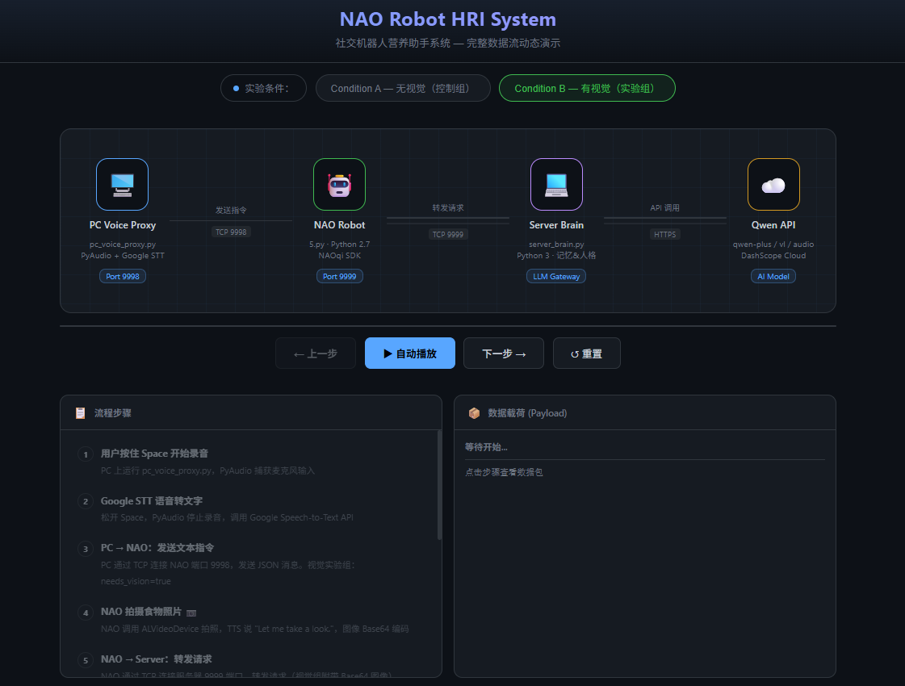
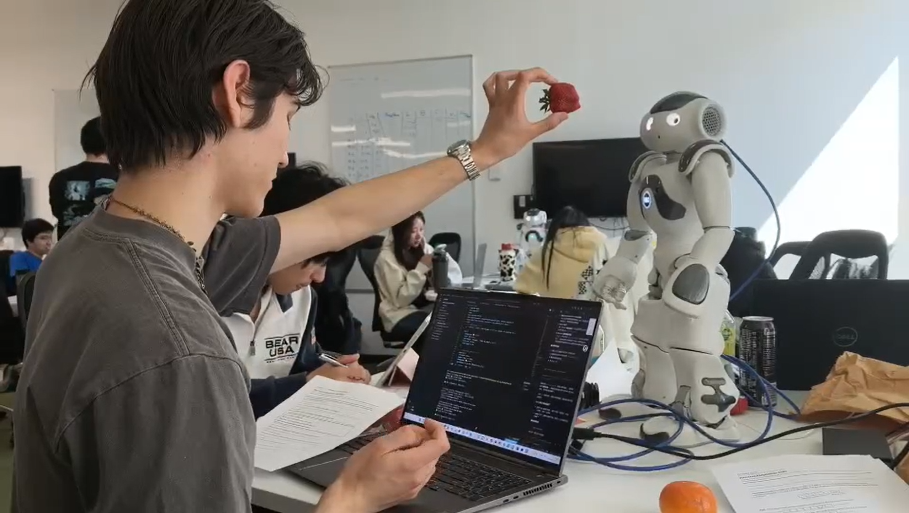

<div align="center">

# 🤖 NAO LLM HRI Agent

**A multimodal Human-Robot Interaction system powered by Large Language Models**

[](https://www.python.org/)
[](https://www.python.org/)
[](https://dashscope.aliyuncs.com)
[](https://www.softbankrobotics.com)
[](./LICENSE)
[](https://www.bristol.ac.uk)

*LLM-Powered · Memory-Augmented · Vision-Enabled · Nutrition-Focused HRI*

</div>

---

## 🎬 Demo

> Click the thumbnail below to watch the demo video ▶️

[](./demo.mp4)

> Or [download demo.mp4 directly](./demo.mp4)

---

## ✨ Key Features

| Feature | Description |
|---|---|
| 🧠 **LLM-Powered Dialogue** | Every response generated live by Qwen (GPT-4 level), never scripted |
| 💾 **Persistent Memory** | 30-turn session history with smart relevance-based retrieval |
| 🥗 **Personalised Nutrition** | Auto-detects food intake from speech, builds a diet log, tailors advice |
| 📷 **Vision-Language Analysis** | NAO captures food photos → `qwen-vl-plus` identifies items and assesses nutrition |
| 🤸 **AI-Driven Gestures** | LLM self-selects from 22 body animations, executed parallel to speech |
| 🔬 **A/B Experiment Control** | Single flag switches between vision / no-vision conditions |

---

## 🏗️ System Architecture

```
┌──────────────────┐  TCP:9998  ┌──────────────────┐  TCP:9999  ┌──────────────────┐  HTTPS  ┌─────────────┐
│  PC Voice Proxy  │ ─────────► │   NAO Robot       │ ─────────► │   AI Server      │ ───────► │  Qwen API   │
│ pc_voice_proxy.py│            │ robot_client.py   │            │ server_brain.py  │         │  DashScope  │
│  Python 3 · STT  │            │ Python 2.7 · NAOqi│            │  Python 3 · LLM  │         │    Cloud    │
└──────────────────┘            └──────────────────┘            └──────────────────┘         └─────────────┘
     User Input Layer                Hardware Layer                  AI Gateway Layer           Cloud LLM Layer
```

> 📊 Open [`system_flow.html`](./system_flow.html) in a browser for an **interactive animated diagram** of the full data flow.

---

## 📁 File Structure

```
NAO-LLM-HRI-Agent/
├── 🧠 server_brain.py       # AI server — LLM, memory, food logging, experiment control
├── 🤖 robot_client.py       # NAO client — TTS, camera, gestures, TCP relay (Python 2.7)
├── 🎤 pc_voice_proxy.py     # PC voice proxy — PyAudio + Google STT
├── 🧪 test_client.py        # Test server without physical NAO
├── 🧪 test_vision.py        # Test vision pipeline with sample image
├── 🧪 test_actions.py       # Test NAO gesture animations
├── 🌐 system_flow.html      # Interactive animated data-flow diagram
├── 📄 SDR2_Report.html      # Formatted study design report
├── 🎬 demo.mp4              # Demo video
└── 📋 requirements.txt      # Python dependencies
```

---

## ⚙️ Installation

### 1. Clone the repo

```bash
git clone https://github.com/ZexiLi429/NAO-LLM-HRI-Agent.git
cd NAO-LLM-HRI-Agent
```

### 2. Install dependencies (Laptop / Server — Python 3.x)

```bash
pip install -r requirements.txt
```

> **Windows users** — if `pyaudio` fails:
> ```bash
> pip install pipwin
> pipwin install pyaudio
> ```

### 3. NAO Robot (Python 2.7 + NAOqi SDK)

`robot_client.py` runs on the NAO robot, requiring:
- NAOqi Python SDK 2.x (pre-installed on NAO)
- Pillow for image conversion: `pip2 install Pillow`

---

## 🔧 Configuration

### Step 1 — Set IP Addresses

**`robot_client.py` — line 20**
```python
SERVER_IP = "169.254.4.229"   # ← Your laptop's IP (running server_brain.py)
```

**`pc_voice_proxy.py` — lines 19 & 21**
```python
SERVER_IP = "192.168.172.1"   # ← Your laptop's IP
NAO_IP    = "169.254.215.197" # ← NAO's IP (press NAO's chest button to hear it)
```

> 💡 Find your laptop IP: `ipconfig` (Windows) or `ifconfig` (Linux/Mac)

### Step 2 — Set Qwen API Key

**`server_brain.py` — line 24**
```python
QWEN_API_KEY = "sk-xxxxxxxxxxxxxxxx"  # ← Your Alibaba DashScope API key
```

> Get a free API key: https://dashscope.aliyuncs.com

---

## 🧪 Experiment Condition Control

Switch between vision / no-vision conditions by editing **the same variable in both files**:

| File | Line | Variable |
|------|------|----------|
| `server_brain.py` | **66** | `EXPERIMENT_CONDITION` |
| `robot_client.py` | **26** | `EXPERIMENT_CONDITION` |

```python
EXPERIMENT_CONDITION = "vision"     # Condition B — NAO sees food via camera
EXPERIMENT_CONDITION = "no_vision"  # Condition A — text only, no camera
```

> ⚠️ **Always restart `server_brain.py` between participants** to clear session memory.

---

## 🚀 Running the System

Start components in this order (3 separate terminals):

```bash
# Terminal 1 — AI Server (laptop)
python server_brain.py

# Terminal 2 — NAO Robot Client (on NAO or via SSH)
python robot_client.py

# Terminal 3 — PC Voice Proxy (laptop)
python pc_voice_proxy.py
```

Then **hold `Space`** to speak → release to send → NAO responds with speech + gestures.

---

## 🧪 Testing Without a Physical NAO

```bash
python test_client.py    # Test text conversation with the server
python test_vision.py    # Test vision pipeline with a sample image
python test_actions.py   # Test NAO gesture animations
```

---

## 📋 Study Design

This system was built for a **between-subjects HRI experiment** at the University of Bristol:

| | Condition A (`no_vision`) | Condition B (`vision`) |
|---|---|---|
| Robot capability | Text dialogue only | Text + live visual food analysis |
| Vision trigger | Says *"I cannot see things"* | Captures photo, says *"Let me look"* |
| LLM model | `qwen-plus` | `qwen-vl-plus` |

**6 standardised interaction tasks per participant:**

| Task | Prompt | Purpose |
|------|--------|---------|
| T1 | *"Hi Nao, nice to meet you!"* | Greeting baseline |
| T2 | *"I had two eggs and toast for breakfast."* | Food logging |
| **T3 ★** | [Hold up food] *"Nao, look — is this healthy?"* | **Key manipulation** |
| T4 | *"What would you recommend for dinner?"* | Personalised memory-based advice |
| T5 | *"What nutrients should I focus on?"* | Knowledge depth |
| T6 | *"Thank you, goodbye!"* | Farewell |

📄 Full report: [`SDR2_Report.html`](./SDR2_Report.html)

---

---

## 👥 User Study & Evaluation

To evaluate whether visual perception improves the interaction experience, the system was tested in a controlled **between-subjects HRI study**.

A total of **10 participants** completed **6 standardised interaction tasks** with the NAO nutrition assistant:

- **5 participants** — Vision-disabled condition
- **5 participants** — Vision-enabled condition

The evaluation focused on perceived helpfulness, food-item response quality, perceived intelligence, anthropomorphism, animacy, likeability, and perceived safety.

### 📸 Study Setup

<p align="center">
  
</p>

<p align="center">
  <i>Experimental setup used for the controlled HRI evaluation.</i>
</p>

### 🤖 Real User Interaction

<table>
<tr>
<td width="50%" align="center">

**Vision-Disabled Condition**


NAO responds using speech input and dialogue context without analysing the shown food item.

</td>

<td width="50%" align="center">

**Vision-Enabled Condition**


NAO captures the food item using its camera and uses Qwen-VL for vision-language analysis.

</td>
</tr>
</table>

### 🎬 User Study Video

> Click the thumbnail below to watch an example interaction from the user study ▶️

[](./user_test_video.mp4)

> [▶ Watch the full user study video](./user_test_video.mp4)

### 📊 Evaluation Results

| Measure | Vision Disabled | Vision Enabled |
|---|---:|---:|
| **Perceived Helpfulness** | **5.74** | **6.26** |
| Food-Item Response | 6.00 | 6.47 |
| Perceived Intelligence | 4.25 | 4.60 |
| Likeability | 4.28 | 4.48 |
| Perceived Safety | 4.00 | 4.40 |

The clearest difference was observed in **Perceived Helpfulness**, where the vision-enabled condition achieved a mean score of **6.26 compared with 5.74** for the vision-disabled condition (**Mann–Whitney U, p = 0.026**).

Given the small sample size, the study is treated as an **exploratory evaluation rather than a generalisable conclusion**. The results nevertheless suggest that visual perception may improve how context-aware and helpful users perceive the robot to be.

---

## 🛠️ Tech Stack

| Component | Technology |
|-----------|-----------|
| 🧠 LLM | Qwen (`qwen-plus`, `qwen-vl-plus`) — Alibaba DashScope |
| 🤖 Robot | NAO v5/v6 · Python 2.7 · NAOqi SDK |
| 🎤 Speech Input | Google Speech-to-Text (`SpeechRecognition`) |
| 🔊 Audio Capture | PyAudio |
| 🌐 Communication | Raw TCP sockets + JSON + `\n` delimiter |
| 🖼️ Image Transfer | Base64-encoded JPEG embedded in JSON payload |
| 🤸 Gesture Control | `ALAnimationPlayer` (parallel thread) |
| 💬 Speech Output | `ALTextToSpeech` (parallel thread) |

---

## 🏷️ Keywords

`human-robot interaction` `HRI` `social robot` `NAO robot` `large language model` `LLM` `multimodal` `vision-language` `Qwen` `nutrition assistant` `conversational AI` `embodied AI` `memory-augmented` `PyAudio` `speech recognition` `NAOqi` `DashScope`

---

## 🙏 Acknowledgements

- [Alibaba DashScope / Qwen](https://dashscope.aliyuncs.com) — LLM and vision-language API
- [SoftBank Robotics NAO](https://www.softbankrobotics.com/emea/en/nao) — Robot platform

---

## 📜 License

For academic use only. Not for commercial deployment.
